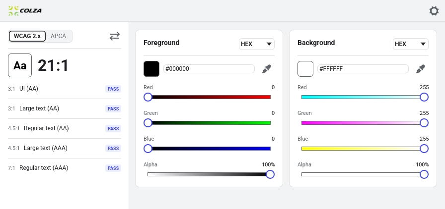

<h1 align="center">
    <picture>
    <source media="(prefers-color-scheme: dark)" srcset="assets/logo-colza-dark.png">
    <source media="(prefers-color-scheme: light)" srcset="assets/logo-colza.png">
    
    </picture>
</h1>

A linux color contrast checker, similar to Colour Contrast Analyser. 

<div align="center">
    <picture>
    <source media="(prefers-color-scheme: dark)" srcset="assets/screenshot-dark.png">
    <source media="(prefers-color-scheme: light)" srcset="assets/screenshot-light.png">
    
    </picture>
</div>

## Features
- **Color picker:** Choose a color on the screen. This requires screenshot and/or screenshare access for full support. Keyboard operable.
- **WCAG/APCA support:** Future-proof. Use whichever suits your needs.
- **Smart input:** Detects the format of the color value you enter in the text field (HEX, RGB(A), HSL, OkLCh).
- **Sliders!:** Tweak the color values to reach the contrast you need.

## Installation

### Requirements
- A **Wayland** session. X11 isn't supported.
- **xdg-desktop-portal** with your desktop environment's backend (`xdg-desktop-portal-kde`, `-gnome`, `-wlr`, `-hyprland`, `-cosmic`…). KDE, GNOME and COSMIC install it by default; on Sway or Hyprland, make sure it's installed and running.

How the color picker works depends on your desktop environment:

| Desktop | Color picker |
|---|---|
| KDE Plasma | Live: pick a color from a live feed of your screen |
| GNOME, Sway, Hyprland, COSMIC, others | Static: pick a color from a screenshot |

Your desktop asks for permission the first time you pick a color. You can reset these permissions in colza's settings.

### Flatpak bundle (recommended)
Download `colza.flatpak` from the [latest release](https://github.com/calanoix/colza/releases/latest), then:

```bash
# Once, if Flathub isn't set up yet (needed for the runtime)
flatpak remote-add --user --if-not-exists flathub https://dl.flathub.org/repo/flathub.flatpakrepo

flatpak install --user ./colza.flatpak
```

Launch from your application menu, or run it with `flatpak run io.github.calanoix.colza`.

To update, download the new bundle and run the same command with `--reinstall`. 

To uninstall: `flatpak uninstall --user io.github.calanoix.colza`.

### Build from source

#### 1. Install the build dependencies
You need a recent stable Rust (Arch's package is fine; elsewhere, use [rustup](https://rustup.rs)), plus the PipeWire and Wayland development files and **libclang** (used to generate the PipeWire bindings).

- **Arch:** `sudo pacman -S --needed rust pipewire clang pkgconf libxkbcommon wayland`
- **Debian / Ubuntu:** `sudo apt install build-essential pkg-config libpipewire-0.3-dev libclang-dev libxkbcommon-dev libwayland-dev`
- **Fedora:** `sudo dnf install gcc pkgconf-pkg-config pipewire-devel clang-devel libxkbcommon-devel wayland-devel`

#### 2. Build

```bash
git clone https://github.com/calanoix/colza.git
cd colza
cargo build --release
```

#### 3. Install

```bash
install -Dm755 target/release/colza ~/.local/bin/colza
install -Dm644 data/io.github.calanoix.colza.desktop \
  ~/.local/share/applications/io.github.calanoix.colza.desktop
install -Dm644 assets/colza-icon.svg \
  ~/.local/share/icons/hicolor/scalable/apps/io.github.calanoix.colza.svg
```

To uninstall, delete those three files.

## Disclosure
The code of this extension was mosty written by AI, though I personally reviewed every single line (because of course it was not accessible). The UI/UX, the name, the logo and this readme are all human-generated.

## License
This project is licensed under the Apache License, Version 2.0 (Apache-2.0). See the [LICENSE](https://github.com/calanoix/flax/blob/main/LICENSE) file for details.